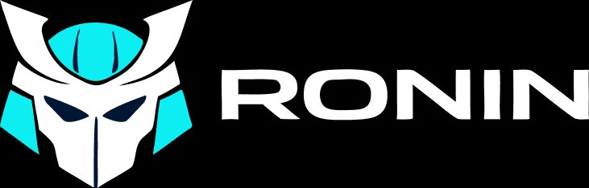

<p align="center">
  
</p>

<h1 align="center">AI Office</h1>
<p align="center"><strong>A miniature isometric 3D world where AI agents work, walk, talk, and hold meetings.</strong></p>
<p align="center">Built with React 19 + Three.js · Single-page app · Local-only Vite service · MIT License</p>

<p align="center">
  
  
  
  
  
</p>

<p align="center">
  <em>What if you could watch AI agents work in a tiny office on your screen?</em>
</p>

<p align="center">
  <a href="http://skill-deploy-qmm7droauc.vercel.app/"><strong>🔗 Live Preview →</strong></a>
</p>

---

## 🌐 Preview

**Try it live:** [**skill-deploy-qmm7droauc.vercel.app**](http://skill-deploy-qmm7droauc.vercel.app/)

Drag to orbit · Scroll to zoom · Slide the time bar · Hit "LIGHTS OFF" for cyberpunk mode · Click `i` for info

---

## ✨ What is this?

**AI Office** is an interactive 3D diorama of a miniature office where 9 AI agents live and work. Each agent has a unique name, role, color identity, animated monitor screen, and behavioral patterns. They walk around the office, bump into each other at the water cooler and have spontaneous conversations, attend scheduled meetings in a glass-walled conference room, and work at their desks with individually animated displays.

This project is a visualization of what happens inside **[RONIN](https://roninos.app)** — an AI operating system being built to remember your taste. The office represents the internal agent architecture: specialized agents collaborating, each owning a domain, each contributing to a shared intelligence.

> The office is a procedural 3D visualization with canvas-animated screens, simulated behavior, and Web Audio. The V5 RONIN chat connects only to a local Ollama service through a read-only Vite middleware; the static site itself does not connect to AI services.

> **SELEBLO OS V5.1:** RONIN uses local Ollama `qwen2.5:3b` first, with `qwen3:4b` as fallback. A local Vite service reads the configured Obsidian vault and maintains a persistent, read-only knowledge index. Other office characters, screen animations, and ticker messages remain visual simulations.

---

## 🤖 The Agents

| Agent | Role | Accent | Screen |
|-------|------|--------|--------|
| **RONIN** | The Builder | `#0DEEF3` Teal | Helmet logo + scrolling code |
| **SAGE** | The Analyst | `#F5A623` Amber | Live bar charts + trend lines |
| **CIPHER** | The Coder | `#00E676` Green | Terminal with blinking cursor |
| **MUSE** | The Creative | `#E040FB` Magenta | Color swatches + floating dots |
| **ATLAS** | The Strategist | `#448AFF` Blue | Connected node map |
| **FORGE** | The Deployer | `#FF9100` Orange | Deploy progress bar + build # |
| **ECHO** | The Researcher | `#7C4DFF` Purple | Research docs with markdown |
| **SPARK** | The Tester | `#FF5252` Red | Test suite pass/fail runner |
| **NEXUS** | The Coordinator | `#CCDDEE` Silver | Reception desk operator |

---

## 🏢 Features

### Office Life
- **Walking agents** — agents randomly get up from their desks, walk to destinations (water cooler, center, window, lounge), pause, and return. Proper alternating leg gait animation.
- **Water cooler conversations** — when two walking agents cross within 1.5 units, a speech bubble appears with dev chat: *"pushing to prod..."*, *"merge conflict 😤"*, *"who broke CI?"*, *"lgtm 👍"*
- **Scheduled meetings** — slide the time to **10:00** or **14:00** to trigger a standup/sprint review. Agents leave desks and appear seated in the glass-walled meeting room. A "Meeting in Progress" badge lights up.
- **Meeting chime** — Web Audio C-E-G ascending tones play when meetings begin.
- **Shift changes** — before 8:00 AM and after 6:00 PM, only RONIN remains in the office. The AI that never sleeps.

### The World
- **9 detailed voxel characters** — unique hair, shirts, pants, shoes, white collar, color-coded wrist badge with point light glow, eyes with pupils
- **Animated monitor screens** — each agent has a canvas-textured display with unique animated content (charts, code, colors, maps, deploy bars, test runners)
- **RONIN's protagonist desk** — dual monitors, tiny helmet trophy with teal visor glow, pulsing teal floor ring, expanding pulse wave
- **Reception area** — desk with RONIN logo image, teal underglow strip, NEXUS seated behind it
- **Meeting room** — glass partition walls, long conference table, chairs, whiteboard with sprint goals
- **Office details** — sofa lounge with coffee table & magazines, printer with status LED, coffee machine with snack bowls & microwave, water cooler, bookshelf with colored books, wall clock (animated, ticking), motivational posters ("SHIP IT", "TASTE > SPEED", "BUILD DAILY"), pendant lights over each desk, AC ducts with vent grilles, potted plants, keyboard with individual keys, mouse, coffee mugs
- **22 flying colored papers** — drifting through the air with tumble, flutter, and bobbing physics
- **Deploy ticker** — scrolling marquee showing real-time agent deployment statuses in their accent colors

### Controls
- **Orbit** — drag to rotate camera around the office
- **Zoom** — scroll to zoom in/out
- **Time slider** — full 24-hour day/night cycle with golden hour lighting transitions
- **Cyberpunk mode** — "LIGHTS OFF" button kills overhead lights, amplifies desk underglow and screen face-lights. Each desk becomes a neon island in the dark. Ceiling tube lights emit dim blue volumetric glow.
- **Info panel** — click the `i` button for project description, RONIN context, and builder credentials

---

## 🌐 Live Preview

**→ [skill-deploy-qmm7droauc.vercel.app](http://skill-deploy-qmm7droauc.vercel.app/)**

Drag to orbit · Scroll to zoom · Slide the time bar · Hit "LIGHTS OFF" for cyberpunk mode · Click `i` for info

---

## 🚀 Quick Start

```bash
git clone https://github.com/Gaurav2693/ai-office.git
cd ai-office
npm install
npm run dev
```

Open [http://localhost:5173](http://localhost:5173) and explore the office.

### Obsidian Vault

The local library reads Markdown files from `~/Downloads/2/SEGUNDO SELEBLO` by default. To use another vault, set `SELEBLO_VAULT` before starting Vite:

```powershell
$env:SELEBLO_VAULT = 'C:\path\to\your\vault'
npm run dev
```

The local API accepts browser requests only when their socket connection is loopback and their Host and Origin are allowed. The original Obsidian notes are read-only; new captures are saved as separate Markdown notes under `_SELEBLO Capturas` inside the configured vault and indexed by the existing persistent knowledge index. `npm run preview` also serves the library locally. Publishing only `dist/` to a static host preserves the 3D experience, but cannot access a vault on your computer.

### Knowledge Capture

Use **＋ Capturar** in the knowledge library to save a typed idea, import a public web page, a public GitHub repository or direct Markdown documentation link, a YouTube video only when its public captions can be retrieved, selected PDF/TXT/Markdown files, or a local Markdown skill folder. Captures are stored in `_SELEBLO Capturas` without changing existing source notes, then indexed and analyzed by the existing indexer and local Ollama model. Repeated source URLs or captured content are detected and reuse the existing indexed note. A saved capture remains searchable if local AI analysis is unavailable; its status distinguishes successful capture from pending analysis.

To continuously sync computer folders, open **＋ Capturar → Selecionar pasta** and choose each specific folder in the Windows dialog. Only those folders are scanned (every 45 seconds while the local SELEBLO service is running); new or changed Markdown, TXT, PDF, image, audio, and video files are catalogued in the existing index. Scans are bounded to 5 MiB per file, 1,200 files and seven nested levels per selected folder, and six new/changed files per scan pass. Hidden, system, credentials, and common dependency folders are skipped. The original stays in place; removing a folder stops future sync and does not delete originals or existing capture notes.

For a page or course that is already open in your authenticated browser, open SELEBLO through its private HTTPS Tailscale address, choose **Preparar favorito de captura**, then create a browser bookmark with the copied code in its URL field. On the course page, activate that bookmark and optionally enter `curso | módulo | aula` and a personal note. It sends the current page URL, title, visible page text, selected text, and annotations to the local capture service; it does not request credentials or bypass page restrictions. If the page blocks or omits text, add permitted notes or screenshots manually. Upload one image at a time in the capture panel; its original copy is kept with the capture. OCR and visual interpretation are not performed, so image/video/audio notes contain only available filenames, paths, hashes, and metadata—not an invented description. Skills remain reference material and are never executed.

Website retrieval follows only public HTTP(S) destinations and redirects, resolves and validates the address used by each socket connection to block DNS-rebinding SSRF, rejects local/private IP addresses and non-standard ports, and is limited to 3 MiB per response. Uploads are limited to 5 MiB per capture; PDF extraction is text-only (no OCR), imported files and repositories are never executed, and GitHub imports fetch a README plus an explicitly selected Markdown file rather than cloning repositories. YouTube captures fail visibly if a public transcript is unavailable; no transcript is generated or invented. Captured content is processed only by the local Ollama instance.

### Private Tailscale Access

The Vite development and preview servers bind to `127.0.0.1`; they are not exposed directly to the LAN. To serve the production build over private HTTPS, install and sign in to Tailscale on this PC and the client device, enable HTTPS certificates for your tailnet, and restrict access with your tailnet ACLs. Then start the preview server and Tailscale Serve in the same PowerShell session:

```powershell
$env:SELEBLO_TAILSCALE_HOST = 'your-device.your-tailnet.ts.net'
npm.cmd run build
npm.cmd run preview
tailscale serve --bg 4173
```

Use the exact HTTPS hostname reported by `tailscale serve` for `SELEBLO_TAILSCALE_HOST`. The Vite host allowlist and local API accept only that configured `.ts.net` hostname and its matching HTTPS origin; local loopback access remains available. The preview server and API stay on loopback, and Ollama remains on `127.0.0.1:11434`. Tailscale Serve supplies the private HTTPS proxy; do not use Tailscale Funnel or forward ports on the router. No Tailscale credentials belong in project files.

This setup is opt-in and is not active until Tailscale is installed, authenticated, and Serve is explicitly enabled. The indexer runs inside the Vite dev/preview process, so it continues with the 3D page closed but stops when that process exits. On Windows, `scripts/start-seleblo-preview.ps1` starts the production preview on loopback and checks that an existing instance is healthy before starting another. To start it after sign-in, create a shortcut to `scripts/start-seleblo-preview.vbs` in the current user's Startup folder. Tailscale Serve keeps its tailnet-only configuration across restarts; the preview must be running before the private URL can load. The script logs startup errors under `%LOCALAPPDATA%\SELEBLO-OS`.

### RONIN Local AI

Install and start Ollama locally, then install the preferred model and its fallback if they are not present:

```powershell
ollama pull qwen2.5:3b
ollama pull qwen3:4b
ollama serve
npm run dev
```

Open the RONIN chat using the on-screen button or by clicking RONIN in the office. The local service indexes Markdown files in the background, even while the 3D panel is closed. It checks for additions, edits, and removals every 15 seconds and persists derived metadata and a keyword index outside the vault at `%LOCALAPPDATA%\SELEBLO-OS\knowledge-index.json` (override with `SELEBLO_INDEX_PATH`). Each note is limited to 1 MiB, with at most 2,500 notes and 128 MiB read per scan. The index stores hashes, extracted headings/URLs, keyword counts, and local Ollama analysis; it does not modify source notes.

Analysis is sequential and rate-limited to one request every eight seconds using only the local Ollama service. If Ollama is unavailable, analysis remains pending and retries later. Link-only notes record their URLs without fetching or describing the remote destination. Extracted facts, AI classifications/summaries, explicit note references, and AI-suggested relations are stored separately. The library displays index/analyzed/pending counts and the selected note's analysis and relations.

RONIN searches the persistent index by content, title, category, and AI keywords, then rereads current originals before using them as sources. It ranks matching text passages and sends only documents with relevant passages (up to three notes and 5,200 characters of context) to the model. Follow-up questions can reuse relevant sources; unrelated relation-only documents are not cited as evidence. The source list is generated from the exact documents sent to Ollama. The index and Ollama endpoints are loopback-only; note content is sent only to Ollama on `127.0.0.1`.

RONIN prioritizes `qwen2.5:3b`, uses a bounded 4,096-token context and 384-token answer budget, and keeps the model warm between requests. A running local analysis is paused while the chat generates a response. The fallback is attempted after an immediate primary-model failure, but not after a generation timeout, which returns a bounded error rather than waiting through a second model. Search, model-selection, Ollama-generation, and total response times are shown with each answer. The model that actually generated each answer is shown in the chat. If Ollama or all installed candidate models are unavailable, the chat reports an error instead of fabricating an AI response. Chat and vault operations are read-only; no skills, shell commands, or document changes are executed.

### Production Build

```bash
npm run build
npm run preview
```

### Deploy

Drop the `dist/` folder on any static host for the standalone 3D experience. The Obsidian library requires the local Vite server and is not available from a static deployment.
- **Vercel**: `vercel --prod`
- **Netlify**: drag & drop the `dist/` folder
- **GitHub Pages**: push `dist/` contents to `gh-pages` branch

---

## 🛠 Tech Stack

| Layer | Tech |
|-------|------|
| UI Framework | React 19 |
| 3D Engine | Three.js |
| Build Tool | Vite 8 |
| Sound | Web Audio API |
| Styling | Inline styles + CSS variables |
| Fonts | Syne · DM Sans · DM Mono · Orbitron |

**Zero dependencies beyond React + Three.js.** No state management library or CSS framework. The RONIN chat uses Ollama on the local machine through the Vite plugin; it does not call hosted AI APIs.

---

## 📁 Project Structure

```
ai-office/
├── plugins/
│   ├── knowledgeIndex.js        # Background persistent Obsidian index and local Ollama analysis
│   └── vaultPlugin.js           # Loopback-only vault, index, and RONIN APIs
├── public/
│   └── ronin-logo.png           # RONIN brand logo
├── src/
│   ├── components/
│   │   ├── Header.jsx           # "THE OFFICE" title bar
│   │   ├── HUD.jsx              # Time slider, status, cyberpunk toggle
│   │   ├── InfoPanel.jsx        # About panel — identity, RONIN, links
│   │   ├── Legend.jsx            # Agent color legend
│   │   └── Ticker.jsx           # Scrolling deploy status marquee
│   ├── scene/
│   │   └── OfficeScene.js       # Complete Three.js scene (~1400 lines)
│   ├── App.jsx                  # Main app — connects 3D scene to React UI
│   ├── main.jsx                 # Entry point
│   └── index.css                # Global styles + CSS variables
├── index.html                   # HTML shell with SEO meta tags
├── package.json
├── vite.config.js
├── LICENSE
└── README.md
```

---

## 🔗 Part of RONIN

**[RONIN](https://roninos.app)** is an AI operating system that remembers your taste. A native macOS command center with:

- **Two-seat intelligence**: RONIN (Sonnet, daily driver) + Dead Shifu (Opus, director)
- **8-gate build pipeline**: Brief → Direction → Figma → Plan → Implement → Review → Ship → Deploy
- **Taste memory**: Contextual, branching preference model — not static settings
- **Multi-surface**: macOS flagship, with iOS, Android, web, CLI, watchOS planned

This office is what the inside of RONIN looks like — specialized agents, each with a role, collaborating to build what you need.

---

## 👤 Built by

**Gaurav Mishra** — Senior Product Designer & Design-Engineer

5+ years building enterprise products. Currently building RONIN — the OS that every design-engineer deserves.

| | |
|---|---|
| 🌐 Portfolio | [gauravmishra.design](https://gauravmishra.design/rooms) |
| 💻 GitHub | [github.com/Gaurav2693](https://github.com/Gaurav2693) |
| 💼 LinkedIn | [linkedin.com/in/imgaurav2693](https://linkedin.com/in/imgaurav2693) |
| 🐦 Twitter | [@GauravM2693](https://twitter.com/GauravM2693) |

---

## 📄 License

[MIT](LICENSE) — use it, fork it, learn from it. Attribution appreciated.

---

<p align="center">
  <sub>If this made you stop scrolling, consider leaving a ⭐</sub>
</p>
